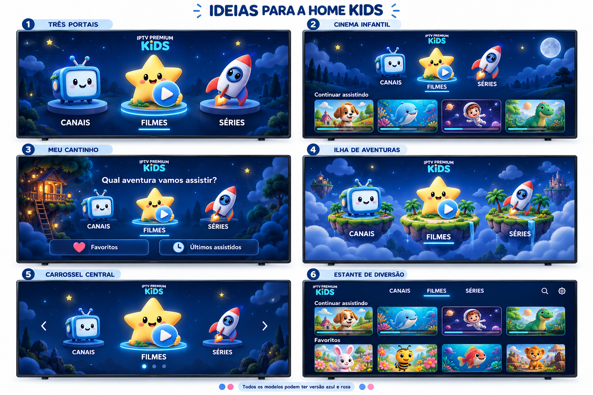

# Ideias visuais para a Home Kids

1. **Três portais:** entrada simples com os três destinos principais.
2. **Cinema infantil:** destinos principais e uma fileira para continuar assistindo.
3. **Meu cantinho:** saudação, destinos principais e atalhos para favoritos e histórico.
4. **Ilha de aventuras:** três ilhas ilustradas com navegação direta esquerda/direita.
5. **Carrossel central:** uma opção em destaque e as demais nas laterais.
6. **Estante de diversão:** navegação compacta e conteúdo em fileiras.

Todos podem ter azul e rosa. As imagens são propostas visuais geradas; personagens, ícones e capas são ilustrativos e não representam os arquivos atuais do aplicativo. Capas reais, histórico e favoritos, se adotados, devem vir dos dados existentes e manter o filtro Kids e o cache compartilhado. Controles adicionais desenhados na proposta 6 são apenas elementos de apresentação, não uma mudança autorizada de funções.

Nenhum código ou recurso do aplicativo foi substituído nesta etapa. Fundos podem ser estáticos e os efeitos de foco breves, adequados ao Android TV. As estrelas e paisagens desenhadas não precisam ficar animadas.
