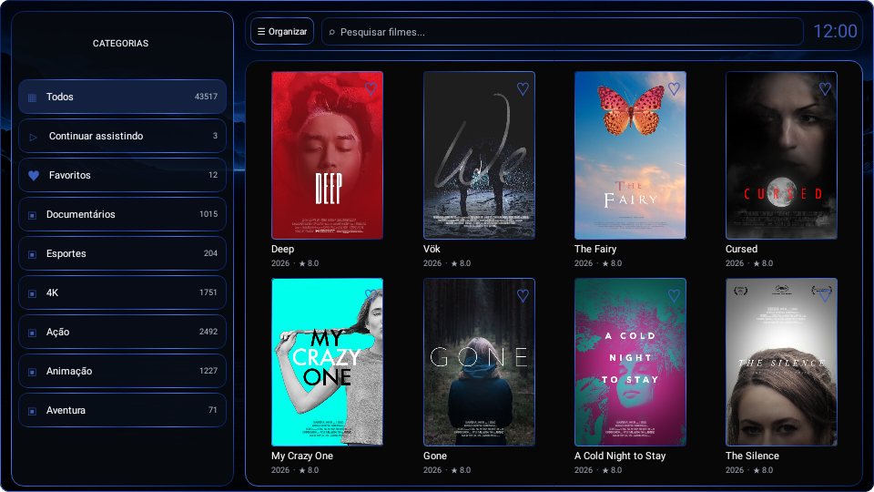
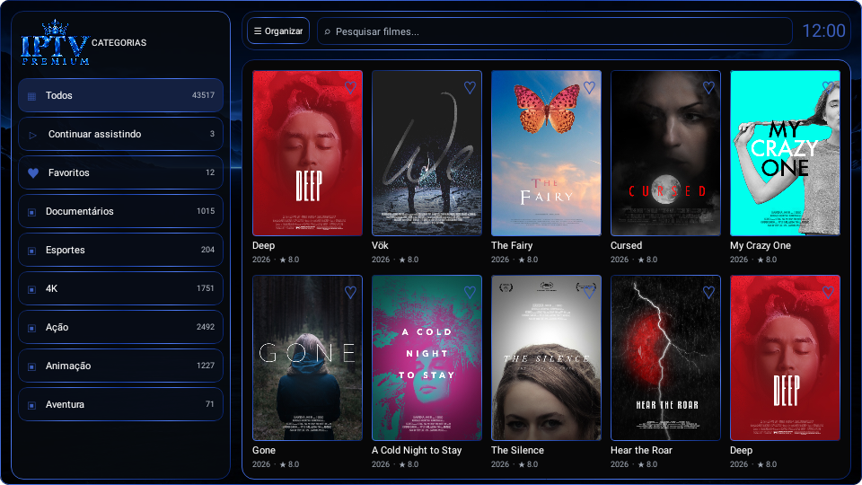

# Esc, barra compacta e prévia com arte real

Atualização cumulativa do projeto `IPTVPremium (5).zip`. Aceita o ZIP original e as duas atualizações anteriores, preservando configurações locais e alterações incompatíveis.

## Mudanças

- Esc recebe encaminhamento no aplicativo mesmo se uma troca de páginas deixar a grade sem um item focado.
- O retorno cancela pedidos de foco pendentes, ativa o modo teclado, rola até a categoria selecionada e pede foco ao próprio item. A restauração automática do grupo foi substituída nesse retorno explícito.
- O primeiro Esc fecha o teclado, quando aberto; na grade, retorna à categoria. Com o foco nas categorias, o próximo Esc segue a navegação normal de saída. Repetir uma tecla mantida pressionada não dispara várias saídas.
- Filmes e séries usam barra de categorias menor: 245 dp no modo compacto e 280 dp no modo amplo, com linhas de 38/42 dp.
- A grade aproveita a largura extra e a margem inferior de 6/8 dp, mantendo duas fileiras de 4 ou 5 capas e a proporção da arte.
- Aparência mostra o fundo real do tema, pôsteres locais em retrato, nomes, metadados e a disposição completa da tela, alternando entre 8 e 10 capas. O cache e o carregamento do catálogo permanecem intactos.

## Prévias renderizadas do aplicativo

As imagens foram renderizadas a partir do componente Compose, com o tema azul. São exemplos de apresentação, sem acesso à playlist do usuário. As artes de exemplo vêm de Android TV Samples; origem e licença são instaladas em `app/src/main/assets/preview-artwork-NOTICE.txt`.

## Aplicação

Na raiz do projeto, use no PowerShell do Android Studio o comando fornecido no chat para baixar `Atualizar-Interface-Esc.ps1`. Ele verifica todos os arquivos antes de escrever, confere a integridade de código e imagens, cria backup em `.navigation-backups` e aceita finais de linha LF ou CRLF. Se encontrar arquivos com mudanças diferentes das versões conhecidas, interrompe sem sobrescrevê-los. Executá-lo novamente não duplica a atualização.

Após aplicar, compile e instale/execute a nova versão do aplicativo. O script não altera credenciais, assinatura ou versões de dependências.

## Validação

- Quatro testes de tela executados com Robolectric e renderização nativa: Esc devolve foco à categoria de filmes; encaminhamento físico e repetição de Esc; retorno a uma categoria de séries abaixo na lista e seleção da próxima com o controle; alternância e renderização das prévias de 4/5 colunas. Todos aprovados.
- Os três testes de comportamento também acompanham o atualizador como `CatalogScreenReturnDeviceTest.kt`, para execução em Android.
- APK debug do aplicativo e APK dos testes Android compilados.
- Atualizador PowerShell executado contra ZIP original, atualização inicial e atualização anterior, incluindo CRLF, imagens binárias, backup, repetição e recusa de conflitos.
- A conferência no aparelho/controle físico do usuário ainda precisa ser feita após instalar a nova versão.
