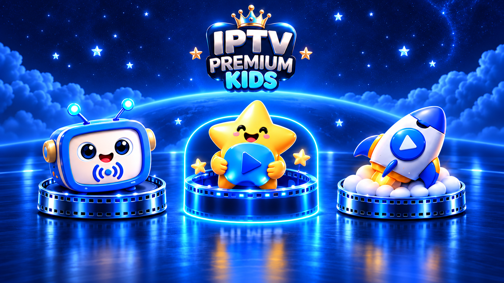
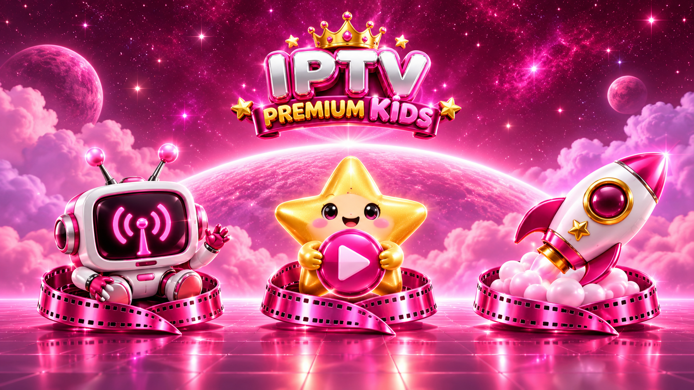

# Kids azul/rosa, categorias infantis e urso com brilho reduzido

Escolha em **Configurações → Aparência → Visual do Kids**. A prévia muda imediatamente e a escolha é salva no aparelho.

| Azul | Rosa |
| --- | --- |
|  |  |

## Comportamento

- Nova Home interna do Kids, inspirada na referência: TV/robô para Canais, estrela/play para Filmes e foguete para Séries. Imagens estáticas com três áreas reais de seleção, foco por controle e rótulos acessíveis. Sem os botões de Home e cadeado marcados com X; voltar funciona pelo controle/Esc.
- A escolha azul ou rosa vale para o ambiente Kids, sem substituir a preferência do menu principal. Ao sair, o tema principal é restaurado sem regravar sua preferência. O urso do menu principal continua acompanhando o tema principal; seu acento agora tem brilho reduzido, mantendo a saturação metálica.
- Canais, Filmes e Séries do Kids recebem cabeçalho com marca/robô Kids e “Minhas aventuras”, fundo com estrelas, nuvens e película, painéis escuros na cor escolhida e símbolos infantis nas categorias. Filmes/Séries têm identificação Kids junto à grade. A estrutura da grade e a rolagem continuam compartilhadas com os catálogos existentes.
- Símbolos conhecidos: robô para Infantil/Desenhos, foguete para Aventuras/Espaço, abóbora para Halloween, fantasma, castelo, tartaruga/natureza, estrela e patinha. Nomes desconhecidos recebem um dos símbolos por sorteio determinístico do nome normalizado. Assim, o ícone não troca ao mover o foco ou reabrir. Continuar/Favoritos conservam símbolos de reprodução/coração.
- Os títulos, categorias e capas continuam vindo da lista e dos mesmos registros/caches. As ilustrações da Home são decoração local; não criam filmes, canais ou séries fictícios, nem outra importação/base/cache de conteúdo.
- O catálogo normal preserva cabeçalhos, busca e aparência existentes. Os novos cabeçalhos e símbolos ficam restritos à sessão Kids.

## Preservado

Capas em grupos de **5**, ciclo inicial de **30**, acrescentando **30** quando restam **25** (reserva chega a **55** no gatilho). Só as próximas cinco preparadas na RAM; prioridade às capas durante o catálogo e cancelamento da fila no clique, como na entrega anterior. JPEG **90**, até **300 × 450**, RGB_565 opaco, Xtream **250**/M3U **2.000**, imagens **100 MB** dentro de **350 MB** de armazenamento gerenciado. As regras de PIN/Kids/Legendados e filtros de conteúdo continuam existentes.

As artes são arquivos do APK, compartilhados pelo cache de arte já existente e pelos seus orçamentos; apenas a variante escolhida é exibida. Não há downloads de ilustrações enquanto a criança navega, animações de partículas ou um segundo cache de capas. As novas ilustrações acrescentam aproximadamente 7 MiB de recursos ao APK; isso é separado do cache gerenciado. Gradle, assinatura e arquivos privados não são alterados.

## Aplicação e backup

Atualizador cumulativo compatível com **IPTVPremium (11).zip**, Kids `fb94c04` e ciclos de capas `69b66a0`. O script contém também as artes, sem downloads separados. Execute o comando de download da revisão publicada informado na entrega, na raiz do projeto do Android Studio.

Verifica todos os hashes antes de gravar, aceita LF/CRLF/BOM, verifica imagens por bytes, cria backup em `.navigation-backups/kids-azul-rosa-*`, restaura após falha e permite reaplicação. Bases com alterações desconhecidas são recusadas sem sobrescrever o projeto. `alteracoes.patch` mostra o ajuste em relação à entrega de ciclos de 30; os PNGs de revisão estão em `artes/`.

## Validação

**71 testes locais passaram, sem falhas ou testes ignorados.** Compilados APKs do aplicativo e de instrumentação. Testes cobrem persistência/seleção das duas versões, preservação/restauração do tema principal, arte azul e rosa renderizada, brilho mais contido do urso, símbolos conhecidos e fallback estável, seleção por controle, ausência dos botões marcados, busca/cabeçalhos, retorno à categoria e preservação de seu ID, Kids/Legendados/PIN, fila e cache de disco, resolução, RAM e armazenamento.

Instalador validado nas três bases, com LF e CRLF/BOM, integridade dos PNGs, reaplicação, preservação do Gradle privado, rejeição de mudanças desconhecidas e recuperação após falha de gravação. O aspecto final e o desempenho na TV ainda precisam de teste no aparelho; compilar instrumentação não significa executá-la na TV.

Testes de revisão opcionais com SDK/JDK do projeto configurados:

```powershell
.\gradlew.bat --no-configuration-cache -I CAMINHO\kids-azul-rosa\testes\validar-kidsvisual.gradle :app:testDebugUnitTest
```
