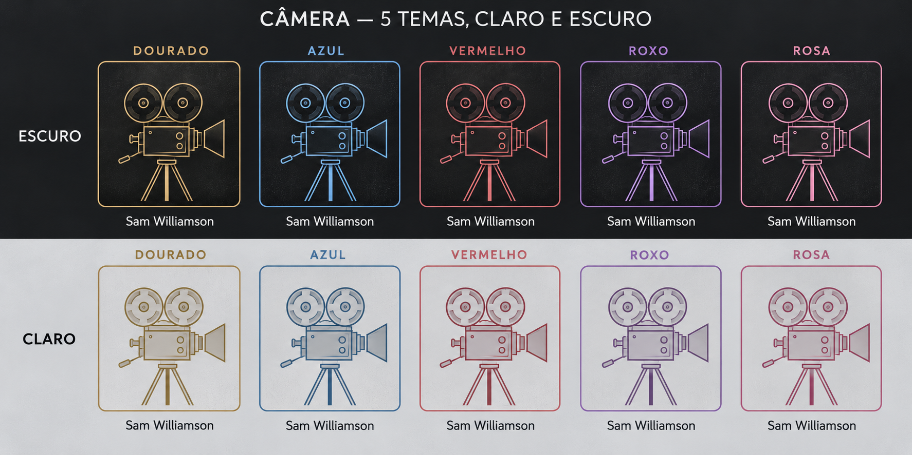

Três sugestões para artistas sem foto

Comparação visual: silhueta, iniciais e claquete. O nome do artista permanece abaixo da imagem. Esta prévia não altera o aplicativo.

Mais opções: máscaras de teatro, câmera de cinema e nome em destaque.

Câmera nos cinco temas, com versões clara e escura. O nome permanece abaixo e fora do cartão. Proposta visual; sem alteração no aplicativo.

