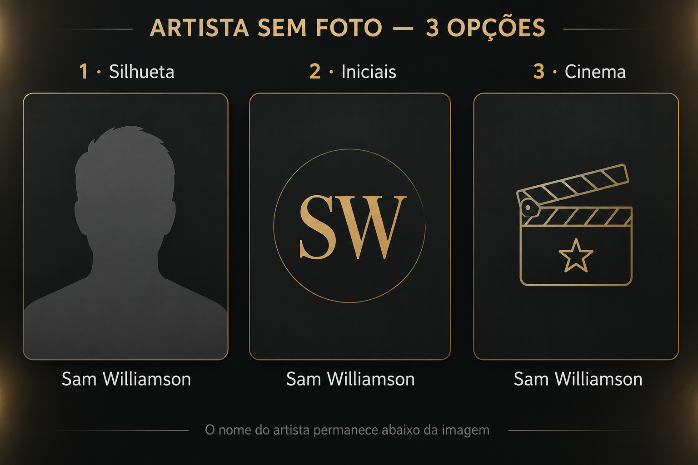
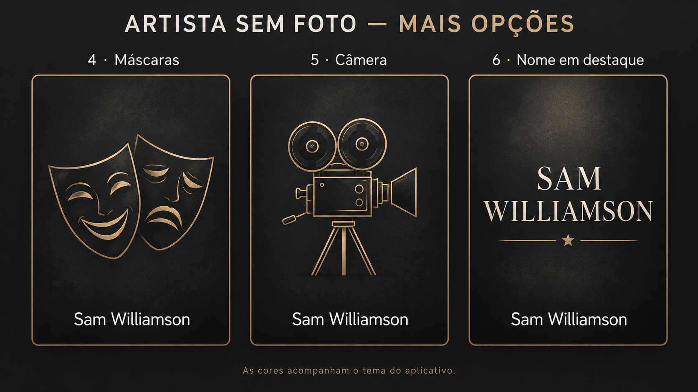

Três sugestões para artistas sem foto

Comparação visual: silhueta, iniciais e claquete. O nome do artista permanece abaixo da imagem. Esta prévia não altera o aplicativo.

Mais opções: máscaras de teatro, câmera de cinema e nome em destaque.

