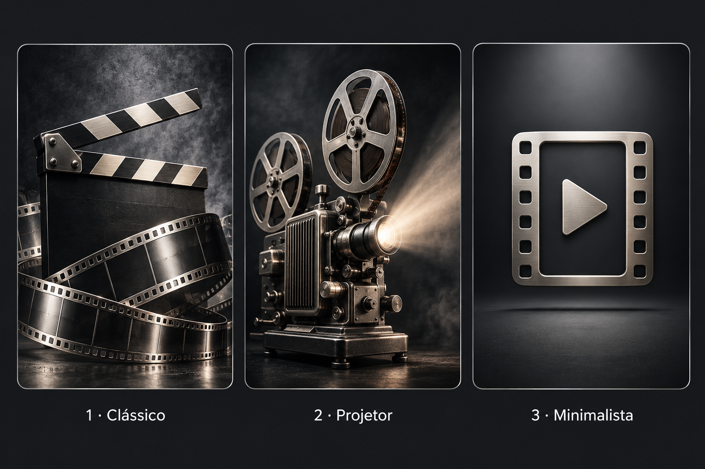
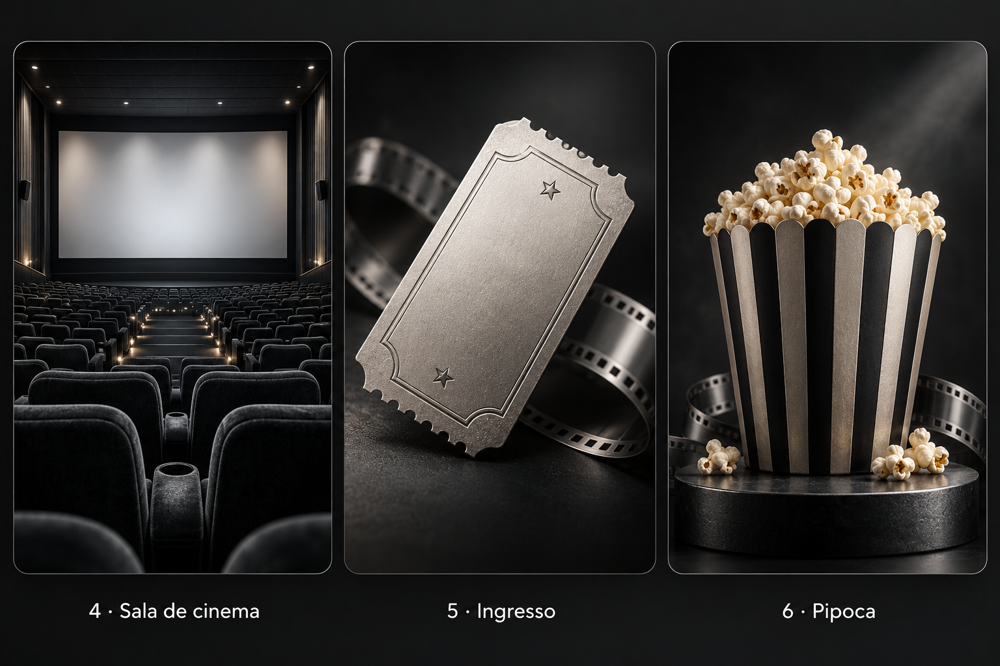

# Três opções de capa genérica

1. **Clássico:** claquete e película, com textura cinematográfica.
2. **Projetor:** projetor antigo com iluminação discreta.
3. **Minimalista:** símbolo de filme com botão de reprodução, fácil de reconhecer na grade.

Prévias em tons neutros de grafite e prata para combinar com os cinco temas. O nome do filme continua abaixo da capa. A opção escolhida poderá ser incluída como um único recurso local compartilhado, sem baixar uma capa genérica para cada título.

São propostas visuais; nenhuma alteração foi aplicada ao aplicativo nesta etapa.

## Mais três opções

4. **Sala de cinema:** poltronas e tela, com atmosfera de cinema.
5. **Ingresso:** bilhete com textura e película ao fundo.
6. **Pipoca:** composição simples com balde em grafite e prata.

Estas opções também são apenas prévias. Nenhuma capa foi aplicada ao aplicativo.
