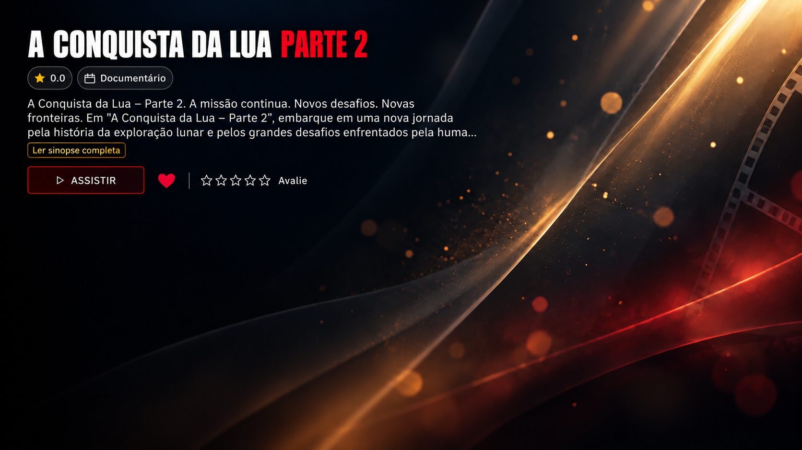

# Prévia sobre o fundo enviado

Prévia visual editada a partir das duas imagens enviadas: fundo limpo e tela de detalhes. Título com fonte alta e estreita em branco e “PARTE 2” em vermelho. Mantém a disposição de informações, sinopse e ações da referência.

Esta é uma simulação visual gerada, não uma captura do aplicativo nem uma nova atualização de código. Não substitui o arquivo original do fundo no projeto.
