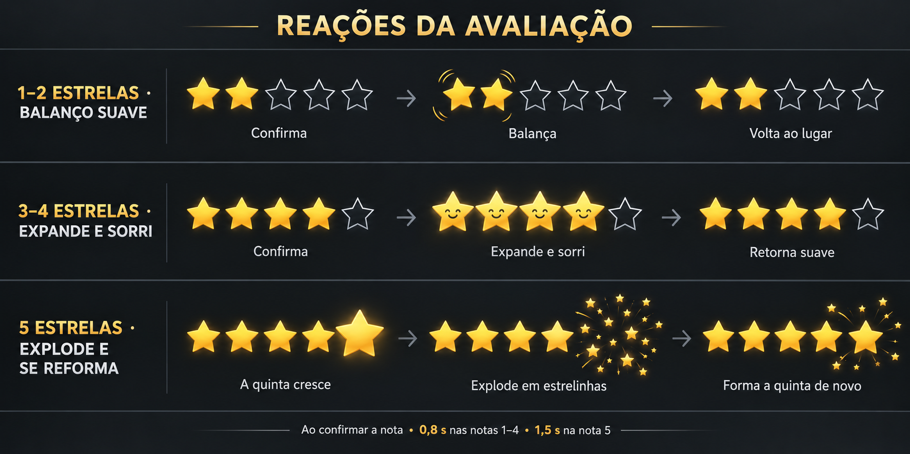

# Prévia das reações da avaliação

Leia cada linha da esquerda para a direita:

- **1–2 estrelas:** as estrelas selecionadas balançam suavemente e voltam ao lugar.
- **3–4 estrelas:** as selecionadas expandem, ganham um sorriso discreto e retornam ao tamanho normal.
- **5 estrelas:** apenas a quinta cresce, se desfaz em estrelinhas que se afastam e depois convergem, reconstruindo a quinta estrela. As quatro anteriores permanecem fixas.

Proposta: até 0,8 segundo nas notas 1–4 e 1,5 segundo na nota 5, somente ao confirmar. A cor poderá acompanhar cada tema; dourado aqui é apenas o exemplo.

Esta imagem é uma prévia estática em quadros, não uma animação executável. Nenhuma alteração aplicada ao aplicativo nesta etapa.
