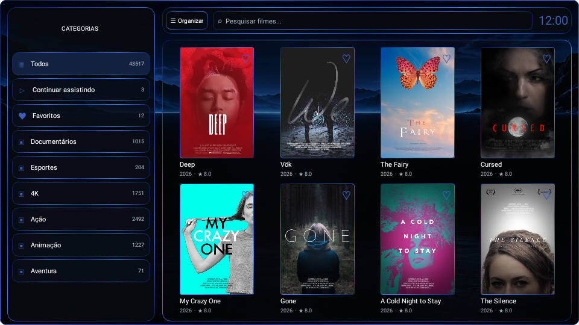
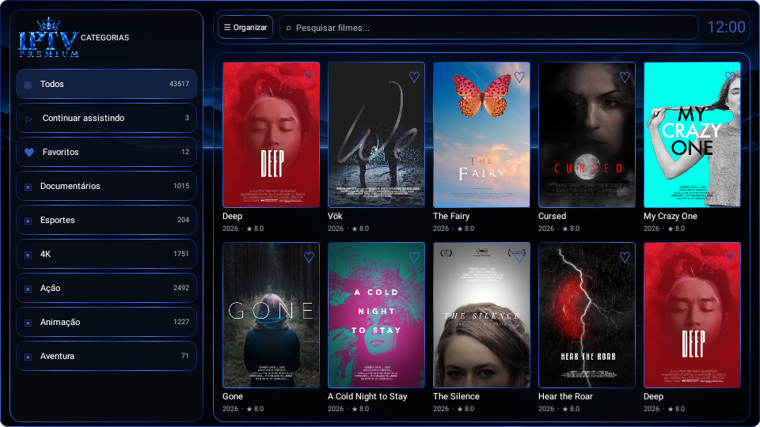

# Rolagem suave e transparência na grade

Atualização cumulativa para `IPTVPremium (5).zip` e para os três atualizadores anteriores.

## Alterações

- Remove os dois textos explicativos marcados na tela de Aparência.
- Substitui o fundo opaco da grade por vidro translúcido, revelando o mesmo fundo desfocado já desenhado atrás da tela. Não desfoca capas, títulos ou avaliações.
- Substitui os saltos de rolagem por movimento contínuo por fileira. O destino acompanha as teclas repetidas e conserva a velocidade da animação ao mudar de direção/destino.
- Preserva a coluna do foco, o tamanho das capas e duas fileiras alinhadas ao terminar cada movimento: 8 capas no modo de 4 colunas ou 10 no modo de 5. Durante o deslizamento, as fileiras entram e saem pela borda do recorte, como na referência.
- Mantém o carregamento e cache de capas, as bordas discretas, a barra compacta e a correção de Esc. A animação não espera downloads de imagens.
- A prévia de Aparência usa o mesmo vidro e fundo desfocado da grade.

## Prévias

## Aplicação no terminal PowerShell do Android Studio

Use o comando do chat na raiz do projeto para baixar e executar `Atualizar-Rolagem-Suave.ps1`. O script confere os arquivos, aceita as versões anteriores conhecidas e LF/CRLF, cria backup em `.navigation-backups` e interrompe se detectar alterações diferentes. Não altera credenciais, assinatura, dependências ou configurações locais. Depois compile e instale/execute a nova versão.

## Validação

- 14 testes de tela executados com Robolectric e renderização nativa, todos aprovados: animação intermediária e alinhamento de duas fileiras em 4/5 colunas; repetição e inversão das setas; preservação da coluna; limites, última fileira incompleta e movimentos horizontais; retorno por Esc; prévias de 8/10 capas.
- APK debug do aplicativo e dos testes Android compilados.
- Atualizador PowerShell validado contra o ZIP e os três estados anteriores, com backup, repetição, CRLF, integridade de imagens e proteção contra conflitos.
- A fluidez no hardware/controle físico da TV deve ser conferida após instalar a nova versão.
