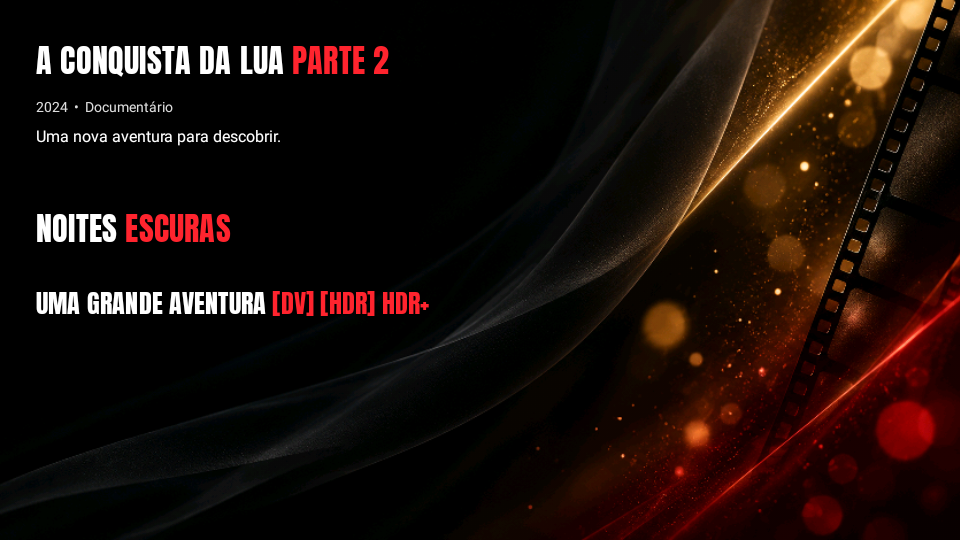

# Títulos de cinema para Filmes e Séries

Fonte Anton local (170.812 bytes), próxima do estilo alto e estreito da referência. É uma fonte existente licenciada sob SIL OFL, e não uma reprodução exata ou uma fonte exclusiva criada do zero. Licença incluída também no APK.

- Título branco; “Parte” seguida de número, DV, HDR, HDR+ e suas versões entre colchetes em vermelho.
- Em títulos de duas palavras, a segunda também fica vermelha. As marcações técnicas e “Parte 2” não contam como palavras para essa regra.
- Acentos preservados, comparação sem diferença de maiúsculas e minúsculas, sem destacar DV dentro de outras palavras.
- Somente o título textual de reserva recebe o estilo: logos próprios continuam com prioridade.
- Fundo genérico estático local para detalhes sem backdrop disponível. É uma adaptação visual da imagem enviada, não o arquivo original da imagem do chat. O fundo próprio do filme/série continua prioritário.
- Um bitmap compartilhado, decodificado em IO em RGB_565 e limitado a 1280×720; com esta arte fica 836×470 (aprox. 0,75 MiB). Sem downloads, cópias por título ou arquivos de cache novos. Arte e fonte são recursos fixos do APK (~1,9 MB).

## Aplicar no Windows

Na raiz do projeto, baixe e execute `Atualizar-Titulos.ps1 -Projeto (Get-Location).Path` e compile com `.\gradlew.bat assembleDebug`.

O instalador aceita os dois estados conhecidos: o último java.zip enviado ou esse mesmo projeto com a atualização Prata/histórico já aplicada. Preserva cada estado e altera somente os dois trechos visuais das telas. Outras versões são recusadas antes da gravação. Há backup, verificação de integridade, repetição segura e restauração se ocorrer erro de escrita.

Não altera versão, Gradle, temas, ícones da Home, player, regras de cache, importação ou histórico. Prévia capturada do componente Compose real; não validado em TV física.
