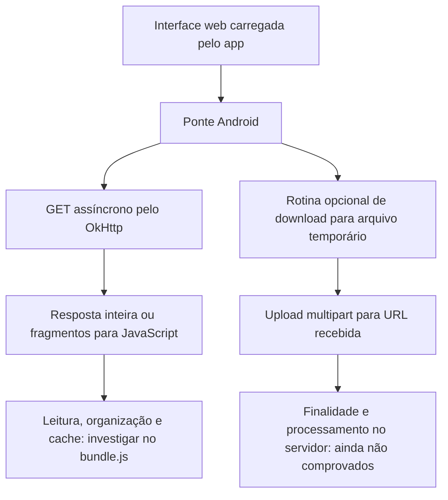

# Análise da importação do IPTV Plus

APK recebido: **IPTV Plus 3.0.4 / versionCode 34**, pacote `com.iptvplusapp.app`.
Tamanho: 89.531.944 bytes. SHA256: `424888c188c3a4e3a711874f38fced0f3e5e811dc87d86367b786a08d0c089bd`.
As quatro partes, seus hashes e o APK reconstruído foram conferidos com o manifesto enviado.

A análise é estática: não houve execução do APK, importação de lista, acesso a credenciais ou alteração no nosso aplicativo. Os componentes principais do aplicativo têm nomes legíveis. Alguns métodos da descompilação possuem avisos; o ramo crítico de download seguido de upload foi conferido também nas instruções DEX, pois o Java reconstruído mostrou uma condição invertida.

## O que o APK comprova

| Achado | Evidência no APK | Limite da conclusão |
|---|---|---|
| Interface HTML/JavaScript em WebView | `MainActivity.init`, `WebEngine.initApp`, `assets/index.html` | Não significa que a importação inteira seja feita no servidor. |
| A interface depende de JavaScript externo | `assets/index.html` cria um script para `https://tv.iptvpluseplayer.live/bundle.js` | O arquivo servido atualmente pode mudar sem atualizar o APK. |
| Ponte JavaScript → Android | `WebEngine.initApp` registra `WebAppInterface` sob o nome `Android` | Os métodos disponíveis não comprovam quais o frontend chama em cada tipo de lista. |
| HTTP assíncrono | `Device.executeHttpRequestAsync` usa OkHttp `enqueue`; a leitura da resposta é despachada por callbacks/threads | Permite concorrência; não comprova quantas requisições de catálogo são feitas simultaneamente. |
| Respostas inteiras podem ser entregues ao JavaScript | `getFromUrl`, `getFromUrlB64` e `getFromUrlB64Splitted` leem `ResponseBody.string()`/`bytes()` antes do retorno | Esse caminho não é um parser incremental de títulos na parte Java analisada. |
| Fragmentação de resposta grande | `WebEngine.setRequestResultSplitted` usa blocos de 3.000.000 de caracteres do texto recebido, que nesse caminho está em Base64 | Esses blocos não são lotes de categorias ou de itens. Não equivalem aos nossos 250/2.000. |
| Existe caminho de download e upload | `WebAppInterface.downloadAndUpload` → `Device.downloadAndUpload` → `FileDownloader` | Sua existência não comprova que ele seja acionado na lista do usuário. |
| O arquivo baixado nesse caminho é temporário | `FileDownloader` cria arquivo com prefixo contendo `.m3u`, lê `byteStream` em blocos de 1.024 bytes e grava em disco | O conteúdo não é analisado como catálogo nessa rotina Java; o nome, sozinho, não comprova o formato real de toda resposta. |
| A rotina envia o arquivo para uma URL fornecida pelo JavaScript | `UploadTask.execute` faz POST multipart com o arquivo em `data` e os campos recebidos `token`/`id`; depois remove o temporário | O destino concreto e a finalidade do processamento precisam do JavaScript ou de observação da execução. Não foram enviados dados por esta análise. |
| Recursos de armazenamento web estão habilitados | `WebEngine.initApp` habilita Database e DOM Storage | Não comprova uso de IndexedDB, formato do cache, duração ou indexação do catálogo. |
| Existe mecanismo de cancelamento | `Device.cancelQueuedRequests` cancela chamadas enfileiradas e em andamento no cliente | A decisão de quando cancelar é feita pela interface; não foi validada na execução. |

O retorno nativo chama `window.APPMANAGER.getAndroidParsedPlaylist(...)`. O nome sugere que a interface buscará um resultado preparado, mas não demonstra por si só onde ou como ele é produzido.

O callback nativo de upload escreve um rótulo de sucesso quando recebe uma resposta, mas não verifica explicitamente `response.isSuccessful()` nesse trecho. Portanto, nem esse rótulo, sozinho, comprovaria processamento concluído com sucesso no servidor.

## Fluxo confirmado e parte ainda desconhecida

## O que ainda NÃO está comprovado

- Se uma M3U compatível é convertida em chamadas Xtream ou lida como arquivo M3U.
- Os endpoints e a sequência de Canais/Filmes/Séries usados pelo frontend.
- Se importa tudo antes de abrir, se prepara por acesso ou se usa carregamento ocioso.
- Se o caminho de upload é usado sempre, apenas em certas listas ou em alguma operação específica.
- Se o catálogo é analisado no JavaScript, em um servidor, ou por uma combinação dos dois.
- O formato do cache e se o cache encontrado explicaria a rapidez observada.
- O número real de requisições paralelas e o tamanho de listas realmente concluídas.
- Qual etapa do nosso aplicativo explica a diferença de tempo. Isso exige medir também nosso download, parsing e gravação com a mesma fonte/formato e estado de cache comparável.

Não foi encontrado um importador de catálogo Room/SQLite nos componentes principais `com.netify.app.Engine` e `com.netify.app.Tools` examinados. As classes genéricas de banco de bibliotecas de vídeo não demonstram uma base local de catálogo. Isso também **não exclui** armazenamento e processamento dentro da WebView.

## Implicação para o nosso aplicativo

O mecanismo identificado é diferente do nosso caminho nativo de streaming, gravação em Room e leitura por Paging. Não há fundamento para concluir que "WebView é mais rápida", que "OkHttp resolve o problema" ou que um tamanho específico de lote explica a velocidade. Nosso aplicativo já oferece streaming e suporte a respostas comprimidas; a presença desses recursos no concorrente não identifica um gargalo nosso.

A hipótese útil é investigar **onde o trabalho é feito e quanto conteúdo fica pronto antes da interface ser liberada**. Se o frontend consultar um catálogo já preparado em servidor, será uma comparação diferente de transformar e gravar o catálogo integralmente no aparelho. Essa hipótese precisa ser confirmada, não aplicada como mudança no projeto agora.

## Próximo arquivo necessário

O JavaScript externo contém a coordenação que falta. O acesso a esse domínio foi bloqueado pela rede deste ambiente, mesmo após nova tentativa com acesso ampliado. Isso é uma limitação de obtenção, não prova de criptografia ou proteção do aplicativo.

O script `Baixar-Interface-IPTVPlus.ps1` baixa somente o arquivo público referenciado pelo APK e calcula seu hash. Ele não executa o JavaScript, não usa credenciais e não lê o aplicativo instalado. Envie o `.js` e o JSON de origem produzidos por ele. Como é um recurso remoto mutável, sua data e hash serão registrados separadamente do APK.

Nenhum APK, código descompilado de terceiros ou dado de lista foi publicado nesta entrega; somente este relatório e os scripts de coleta preparados por nós.
