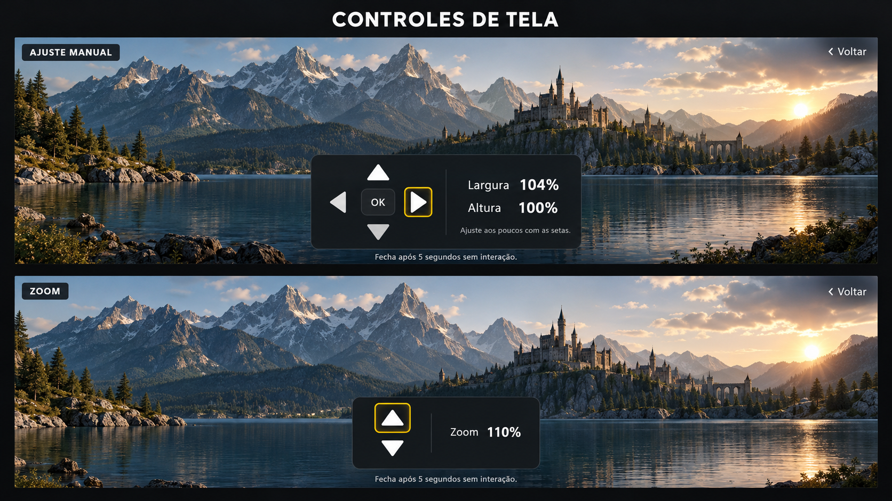

# Configuracoes, listas e controles de tela

Padrao visual aprovado: superficies cinza opacas, texto neutro, contornos na cor dos icones da Home. Aparencia usa a propria Home como previa, com opcoes a esquerda. Tema Amarelo; vermelho com saturacao reduzida em 20%. Fundo novo sem logotipo.

Importacao M3U/Xtream e gerenciamento de listas acompanham o mesmo estilo. O painel de formato e compartilhado por filmes, series e canais: Normal, Zoom, Tela cheia e Ajuste manual, sem fechar ao selecionar. Triangulos preenchidos, passo de 2%, OK para voltar as opcoes. Fechamento apenas em Voltar ou cinco segundos sem entrada.

## Referencia visual aprovada

Esta imagem e a referencia de design, nao uma captura executada na TV. A imagem do filme abaixo e ilustrativa: o aplicativo mantem o video em reproducao.

## Aplicacao

Baixe `configuracoes-menu-tv.zip`, extraia e execute `Aplicar.ps1 -Projeto <pasta> -Testar`, depois `Instalar-TV.ps1`. Base: Home 9e4bea2. O pacote preserva dados e faz backup; `Desfazer.ps1` restaura as fontes. Validacao detalhada em [VALIDACAO.txt](VALIDACAO.txt). Teste final na TV pendente.
