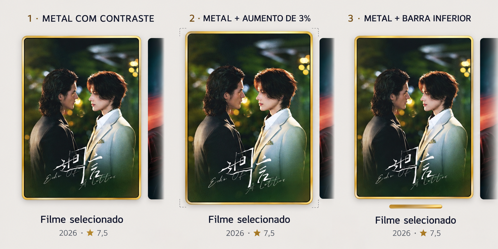

# Seleção de capas — três exemplos

1. Metal com contraste: borda metálica, separador escuro fino e sombra curta.
2. Metal com aumento de 3%: mesmo acabamento e pequeno crescimento da capa.
3. Metal com barra inferior: acabamento metálico e barra curta abaixo da capa.

São propostas visuais; não alteram o aplicativo. Imagem ilustrativa para comparar os tratamentos.

