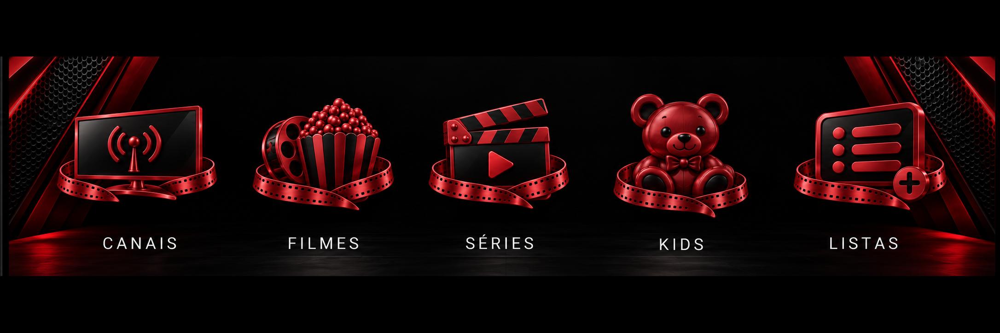

# Ícones padronizados — exemplo para aprovação

Conjunto redesenhado em vermelho metálico acetinado e preto, reflexos discretos, mantendo o modelo antigo do urso com corpo vermelho. Exemplo visual para aprovação, sem aplicar mudanças no aplicativo.
