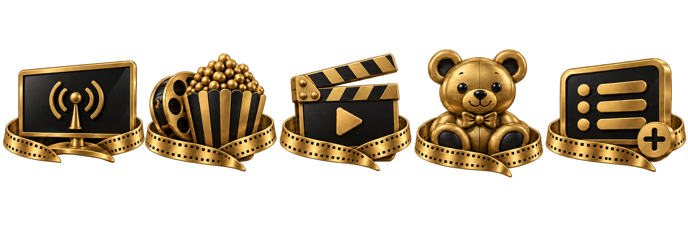
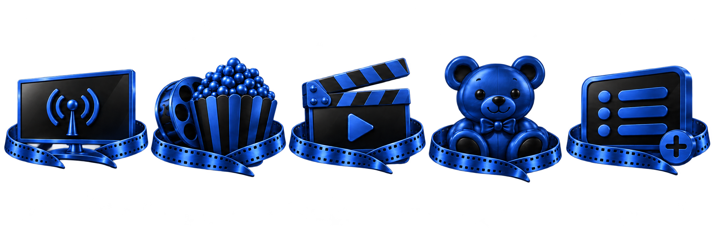
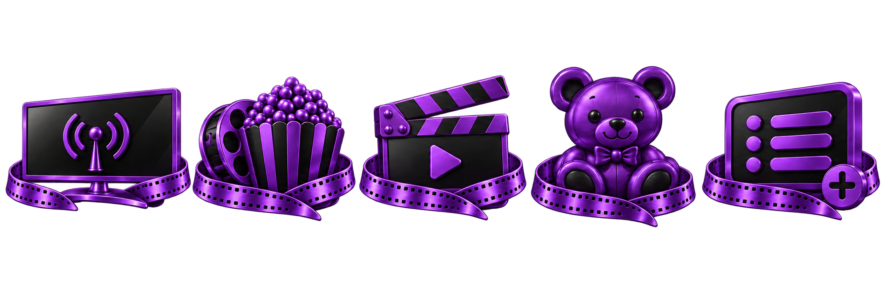
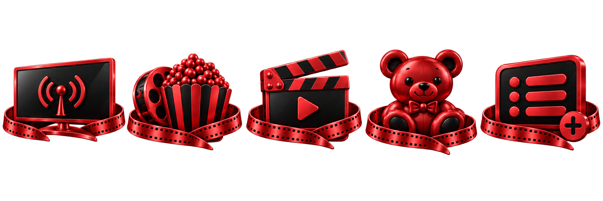
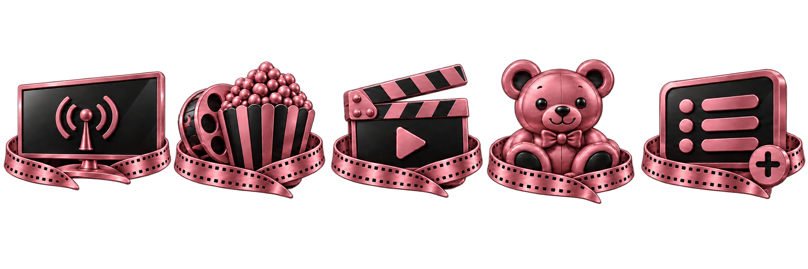
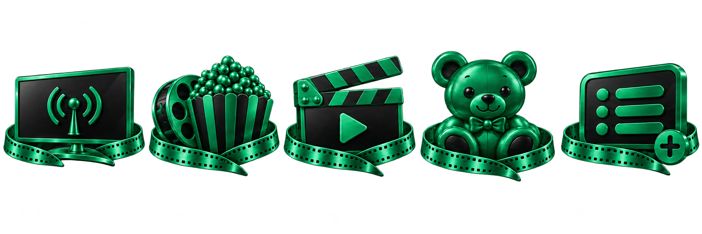
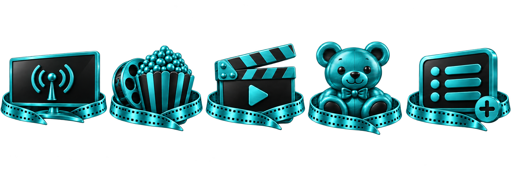

# Ícones padronizados — todos os temas

Conjunto baseado no modelo aprovado: Canais, Filmes, Séries, Kids e Listas. Urso no modelo antigo, cor de cada tema e acabamento metálico acetinado com reflexos controlados.

Sete faixas PNG com transparência, uma por tema, sem nomes embutidos. Os nomes devem ser desenhados pela interface, centralizados e na mesma linha.

[Baixar todas as artes](icones-todos-temas.zip) · [Prévia HTML para abrir após baixar e extrair](previa.html)

## Dourado

## Azul

## Roxo

## Vermelho

## Rosa suave

## Verde-esmeralda

## Ciano / Turquesa

## Situação da aplicação

As artes estão preparadas; não foram aplicadas no APK. O src.zip atualizado enviado nesta solicitação excede o limite de leitura de 32 MiB da ferramenta. Para integrar com segurança, é necessário enviar um ZIP menor com os arquivos atuais dos ícones e os arquivos Kotlin da Home/temas. Não foi utilizada uma versão antiga do projeto para sobrescrever a Home atual.

A prévia permite alternar os sete temas e verificar nomes centralizados e a barra fina entre ícone e nome. Não usa seleção quadrada. O pacote contém artes, não um instalador nem APK. Não inclui alteração de fundo, player, catálogo ou navegação.
