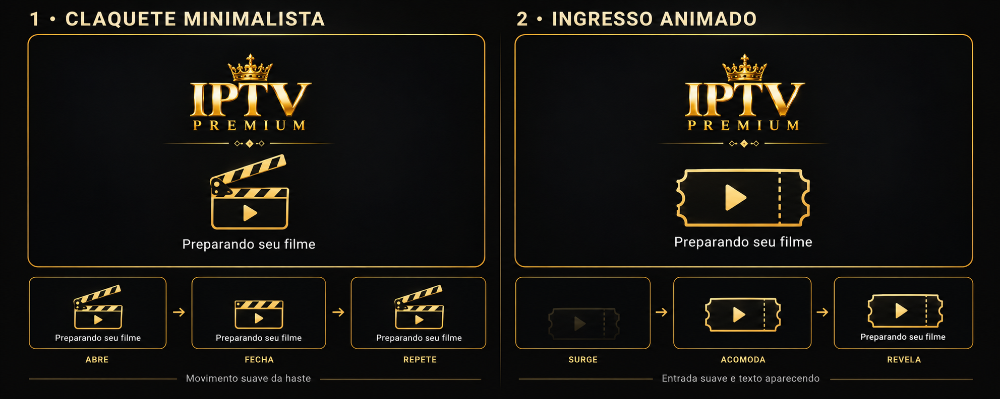

# Opções de carregamento — claquete e ingresso

1. Claquete minimalista: haste abre e fecha lentamente, com logo e texto fixos.
2. Ingresso animado: surge suavemente e revela a mensagem.

Proposta visual estática com quadros do movimento; não altera o aplicativo.
