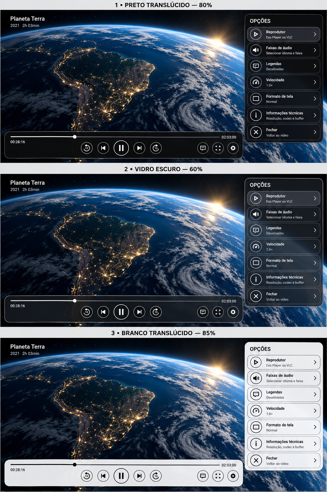

# Tres opcoes de transparencia no layout atual

Proposta visual para revisao; nenhuma alteracao no aplicativo. 1: preto translucido 80%. 2: vidro escuro 60%. 3: branco translucido 85%. Percentuais ilustrativos. Mantem barra inferior, botoes circulares e menu lateral com linhas delimitadas.

