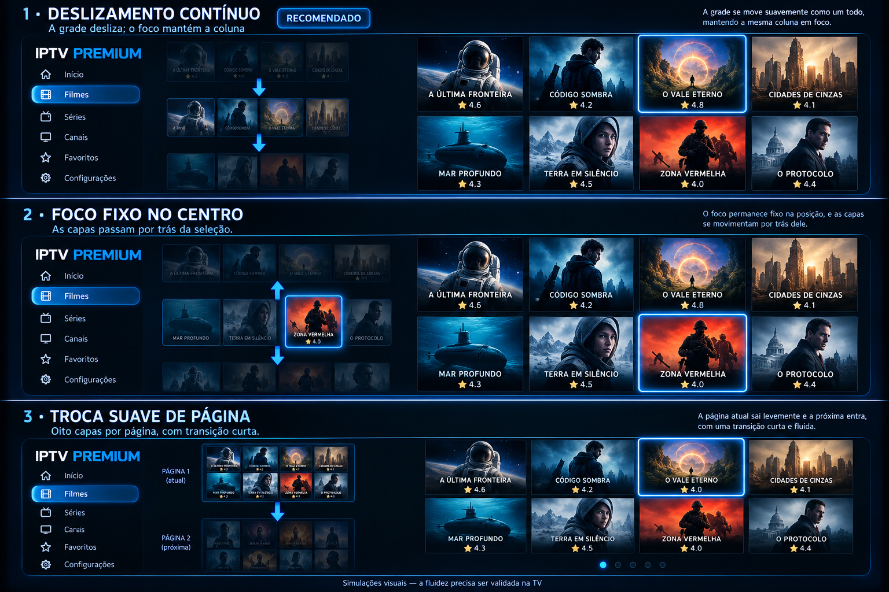

# Opções de rolagem — IPTVPremium

1. **Deslizamento contínuo (recomendado):** a grade desliza inteira, mantendo a coluna. Ao soltar o botão, alinha a fileira.
2. **Foco fixo:** a seleção permanece numa posição vertical e as capas deslizam por ela.
3. **Página suave:** troca o conjunto de oito ou dez capas com uma transição curta.

Simulações visuais para escolha. Nenhuma alteração de comportamento foi implementada nesta entrega. A fluidez deverá ser validada na TV. Preservar capas inteiras e nome e nota abaixo das imagens; o quadro é ilustrativo.
