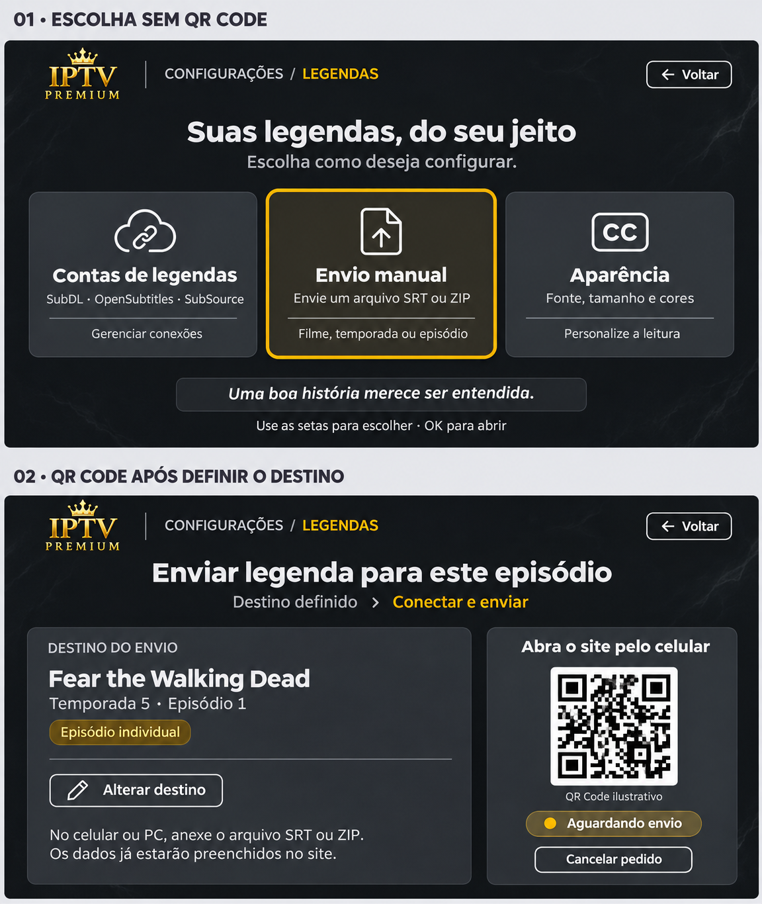
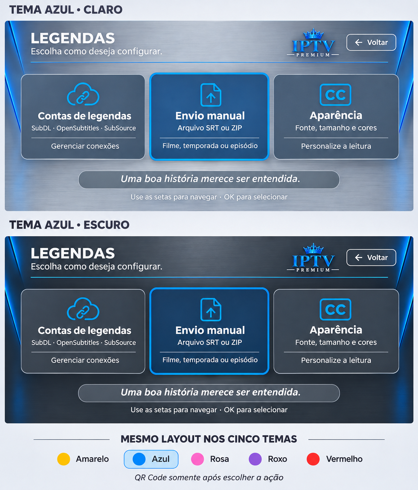

# Proposta visual — configurações de legendas

Prévia conceitual solicitada em 12/11/2026. Não modifica o aplicativo nem implementa upload, QR ou backend.

## Entrada

Três opções: Contas de legendas, Envio manual e Aparência. Nenhum QR Code na entrada. Grafite, painéis cinza, texto claro e foco na cor do tema; a imagem exemplifica o tema amarelo/dourado escuro.

## QR somente quando necessário

- Contas: escolher o provedor e a ação de criar/conectar antes de mostrar o QR apropriado.
- Manual: escolher filme ou série; para série, temporada inteira ou episódio. Depois de definir o conteúdo e iniciar a conexão, mostrar QR de envio e resumo do destino.
- Aparência: abrir fonte, tamanho e cores diretamente, sem QR.

O exemplo mostra Fear the Walking Dead, temporada 5, episódio 1, apenas como dado ilustrativo. O QR da imagem é ilustrativo e não corresponde a um pedido real. O site receberia o destino preenchido pela TV, anexaria SRT/ZIP e acompanharia o recebimento. O fluxo técnico continua sendo uma proposta a desenvolver no Android e backend.

Os outros temas usariam seus acentos; o modo claro usaria os painéis claros existentes. Não foram produzidas prévias individuais dessas variações nem alterados seus recursos. A imagem é um estudo visual gerado, não uma captura executada do app.

## Adaptação à identidade atual enviada pelo usuário

Nova proposta baseada nas fotos do aplicativo: fundo cinza/prateado ou grafite, detalhes azuis laterais, logo no canto superior direito, cartões arredondados e ícones de contorno. Mantém Contas de legendas, Envio manual e Aparência, sem QR na entrada. O azul é a demonstração completa na imagem; amarelo, rosa, roxo e vermelho aparecem apenas como amostras de acento para a mesma estrutura. As dez combinações de tema/modo não foram todas renderizadas.

As cores, fundos, logo e controles finais devem usar os recursos e paletas existentes do tema selecionado, com contraste apropriado em claro/escuro, sem fixar azul no código nem reutilizar o fundo dourado da primeira ideia. A imagem é uma referência visual aproximada, não uma captura do app ou uma mudança implementada. As fotografias pessoais de referência não foram publicadas.
