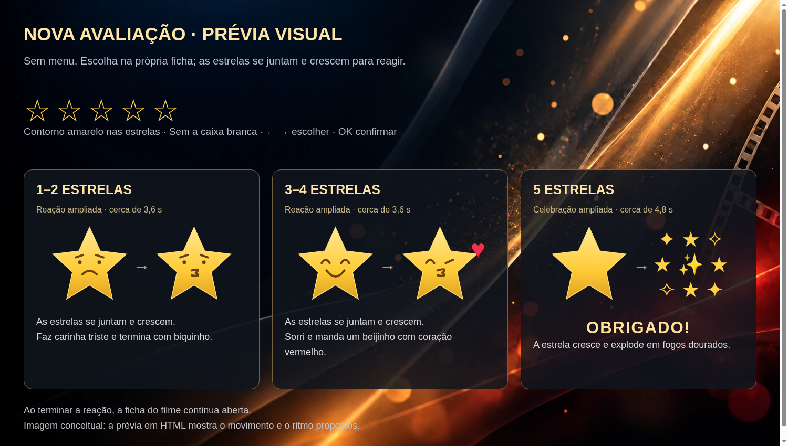

# Prévia da nova avaliação

Esta entrega é somente uma prévia visual. Não modifica o aplicativo.

Seleção diretamente nas estrelas da ficha, com contorno amarelo e sem menu de avaliação. Ao confirmar, as estrelas se juntam e aumentam para apresentar a reação:

- **1–2:** carinha triste, terminando com biquinho, cerca de 3,6 segundos.
- **3–4:** sorriso e beijinho com coração vermelho, cerca de 3,6 segundos.
- **5:** expansão e explosão em fogos dourados, com **OBRIGADO!**, cerca de 4,8 segundos.

Depois, a ficha do filme continua aberta.

## Ver o movimento

Baixe [previa-avaliacao.html](previa-avaliacao.html) usando o botão de download do GitHub e abra no navegador. O arquivo inclui o fundo e funciona sem internet. Use os três botões de demonstração ou selecione as estrelas na ficha. No teclado, Enter inicia a seleção, setas escolhem e Enter confirma.

As caixas na imagem comparativa servem apenas para separar os exemplos. Na prévia animada, a reação aparece sobre a própria ficha, sem janela.
